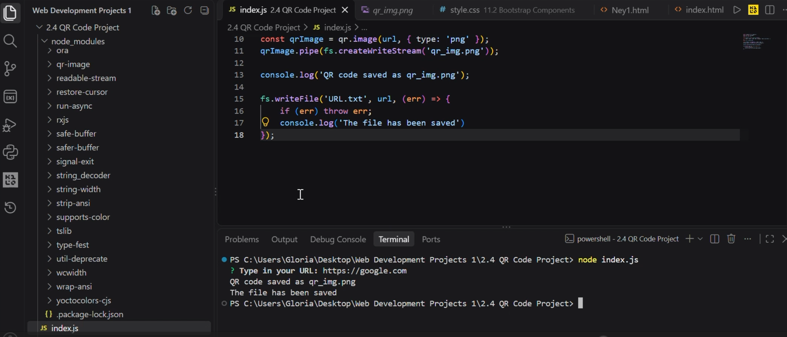

# The QR Code Generator using Node.js

A command-line app that turns a URL into a QR code image and saves the URL to a text file.

## Screenshot

## How to run
1. Clone the repo
2. Run `npm install`
3. Run `node index.js` and type in a URL

## Built with
- Node.js
- Inquirer
- qr-image
- fs (built-in)
